  

<!-- charts:start -->

 

 

<!-- charts:end -->

<!-- numbers:start -->

The numbers behind the charts

| Month | Contributions |
|---|---|
| Nov 2025 | 0 |
| Dec 2025 | 3 |
| Jan 2026 | 159 |
| Feb 2026 | 106 |
| Mar 2026 | 85 |
| Apr 2026 | 110 |
| May 2026 | 47 |
| Jun 2026 | 21 |
| Jul 2026 | 94 |
| Aug 2026 | 88 |
| Sep 2026 | 103 |
| Oct 2026 | 184 |
| Nov 2026 | 50 |

| Weekday | Contributions |
|---|---|
| Mon | 216 |
| Tue | 264 |
| Wed | 134 |
| Thu | 174 |
| Fri | 202 |
| Sat | 35 |
| Sun | 25 |

Peak day: **2026-10-19** with **83** contributions ·
Average on an active day: **5.4** ·
Window: 368 days

<!-- numbers:end -->

**[browse all 21 repos](https://github.com/malikanubhav?tab=repositories)**  ·  **[linkedin.com/in/anubhav010](https://www.linkedin.com/in/anubhav010)**

<!-- Cards are animated SVGs redrawn daily by scripts/render_cards.py
     (.github/workflows/cards.yml) from the public contribution calendar.
     Edit outside the charts/numbers markers; inside them gets overwritten.
     Also available but not shown: months-*.svg, cumulative-*.svg -->
