<!-- cards:start -->

  

  
<!-- cards:end -->

<!-- numbers:start -->

The numbers behind the cards

| Month | Contributions |
|---|---|
| Dec 2025 | 3 |
| Jan 2026 | 159 |
| Feb 2026 | 106 |
| Mar 2026 | 85 |
| Apr 2026 | 110 |
| May 2026 | 47 |
| Jun 2026 | 21 |
| Jul 2026 | 94 |
| Aug 2026 | 88 |
| Sep 2026 | 103 |
| Oct 2026 | 184 |
| Nov 2026 | 53 |

1,053 contributions over 369 days (2025-11-23 to 2026-11-26) ·
195 days with a commit · longest streak **16** days ·
busiest day **2026-10-19** with **83** ·
average on an active day **5.4** · 23 public repos

<!-- numbers:end -->

**[anubhavmalik.com](https://www.anubhavmalik.com)**  ·  **[browse all repos](https://github.com/malikanubhav?tab=repositories)**  ·  **[linkedin.com/in/anubhavmaliksde](https://www.linkedin.com/in/anubhavmaliksde)**

<!-- Cards are animated SVGs in cards/, drawn by scripts/render_cards.py and
     redrawn daily by .github/workflows/cards.yml from the public contribution
     calendar. Text inside the cards:/numbers: markers is overwritten on each
     run; edit outside them, or edit the copy at the top of the script. -->
